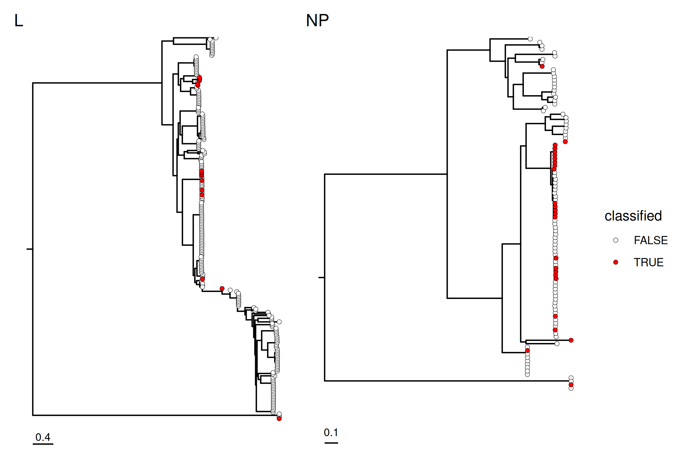
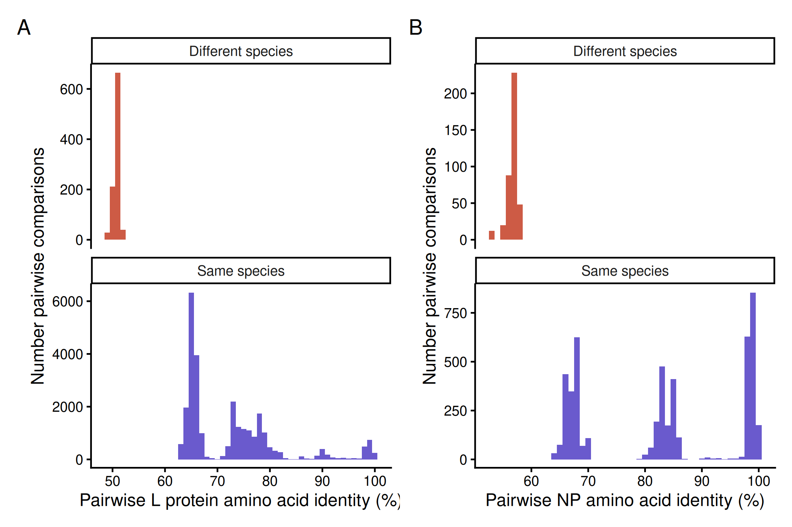

---
format:
  html: default
  docx: 
    reference-doc: custom-reference-doc.docx

bibliography: references.bib
csl: asm.csl #Get themes at https://github.com/citation-style-language/styles
crossref:
  custom:
    - kind: float
      key: suppfig
      latex-env: suppfig
      reference-prefix: Supplemental Figure
      space-before-numbering: true
      latex-list-of-description: Supplementary Figure
    - kind: float
      key: supptab
      latex-env: supptab
      reference-prefix: Supplemental Table
      space-before-numbering: true
      latex-list-of-description: Supplementary Table
    - kind: float
      key: box
      latex-env: box
      reference-prefix: Box
      space-before-numbering: true
      latex-list-of-description: Box
---

```{r knitr_settings, eval=TRUE, echo=FALSE, cache=FALSE}
suppressPackageStartupMessages(library(tidyverse))
suppressPackageStartupMessages(library(knitr))
suppressPackageStartupMessages(library(xfun))

options(tidyverse.quiet = TRUE)

opts_chunk$set("tidy" = TRUE)
opts_chunk$set("echo" = FALSE)
opts_chunk$set("eval" = TRUE)
opts_chunk$set("warning" = FALSE)
opts_chunk$set("message" = FALSE)
opts_chunk$set("cache" = FALSE)

inline_hook <- function(x, digits=2){

  if(is.list(x)){
    x <- unlist(x)
  }
  if(is.numeric(x)){
      sprintf(paste0("%0.", digits, "f"), x)
  } else {
      paste(x)
  }
}
knitr::knit_hooks$set(inline=inline_hook)

if (interactive()) {
   # if running via RStudio, interactively
   baseDir = "../workflow_output/"
} else {
   # if not running interactively, so if being rendered by quarto
   baseDir = "./"
}
```

# Pervasive coinfection, reassortment, and recombination of reptarenaviruses inspire a new *Reptarenavirus* taxonomy

<br>

Mark D. Stenglein^1^*, Michael J. Buchmeier^2^, Jean-Paul Gonzalez^3^, Jussi Hepojoki^4,5^, Jens H. Kuhn^6^, Sylvanus A Okogbenin^7^, Sheli R Radoshitzky^8^, Manuela Sironi^9^, Jiro Yasuda^10^, Juan Carlos de la Torre^11^

<br>

*: Correspondence: Mark.Stenglein@colostate.edu

<br>

1. Colorado State University, Fort Collins, CO, USA
2. University of California, Irvine, CA, USA
3. Georgetown University, Washington, DC, USA
4. University of Helsinki, Medical Faculty, Medicum, Department of Virology, Helsinki, Finland
5. University of Zurich, Vetsuisse faculty, Institute of Veterinary Pathology, Zurich, Switzerland
6. Independent Researcher, Frederick, MD, USA
7. Irrua Specialist Teaching Hospital, Irrua, Nigeria
8. Center for Drug Evaluation and Research, Food and Drug Administration, Silver Spring, MD, USA
9. University of Milano-Bicocca, Monza, Italy
10. Nagasaki University, Nagasaki, Japan
11. The Scripps Research Institute, La Jolla, CA, USA



## Abstract

Reptarenaviruses (family *Arenaviridae*: genus *Reptarenavirus*) infect alethinophidian snakes. Some infected snakes develop boid inclusion body disease, a progressive neurologic condition, but many infections are subclinical and persistent. Reptarenaviruses have bisegmented ambisense RNA virus genomes. Reptarenavirus coinfection is common, and often consists of complex mixtures of multiple S and L genome segments in individual snakes. Coinfection provides an opportunity for genome segments to reassort and recombine and both phenomena have been commonly detected. This widespread coinfection, reassortment, and recombination complicate taxonomic classification, and 85% of reptarenavirus sequences are not assigned to a reptarenavirus species under current criteria. We outline a substantially revised reptarenavirus classification consisting of only two species, corresponding to groups of reassorting viruses that share ≥60% pairwise amino-acid identity across large protein (L) and nucleoprotein (NP) sequences. This reassortment-based grouping is analogous to the classical biological species concept based on reproductive isolation and follows the taxonomic example of other groups of frequently reassorting viruses, including influenza viruses and rotaviruses. This scheme enables classification of all known reptarenaviruses while accommodating the biological and genotypic complexity of the group.



## Introduction

Reptarenaviruses (*Negarnaviricota*: *Bunyaviricetes*: *Arenaviridae*) are bisegmented single-stranded ambisense RNA viruses that produce enveloped spherical to pleomorphic virions [@Radoshitzky2023; @Ly2023]. Reptarenavirus genomes are ≈10.6 kb in total length. The large (L) segment encodes the L protein, which contains an RNA-directed RNA polymerase domain that mediates genome replication and transcription, and a small zinc-binding (Z) protein. The small (S) segment encodes a glycoprotein precursor (GPC) that is processed into virion spike proteins, and a nucleoprotein (NP), which encapsidates viral RNA [@Radoshitzky2023].

Reptarenaviruses were originally identified in association with cases of inclusion body disease (IBD), a progressive neurological disease of boid and pythonid snakes (families Boidae and Pythonidae) [@Schumacher1994; @Chang2010; @Stenglein2012; @Hetzel2013; @Bodewes2013]. Experimental infections confirmed a causal role in IBD pathogenesis, but not all infected snakes got sick, and disease manifestation appears to be a function of multiple variables, including host species [@Stenglein2017; @Hetzel2021; @Chang2016; @Hyndman2019; @Simard2020]. Snakes can remain persistently and subclinically infected for months or years with high viral RNA levels and inclusion bodies in multiple tissues [@Stenglein2017; @Hetzel2021]. Nearly all reports of reptarenavirus infection have involved snakes from diverse genera in Boidae and Pythonidae [@Stenglein2012; @Hetzel2013; @Bodewes2013; @Stenglein2015; @Aqrawi2015; @Chang2016; @Argenta2020 ; @AlfaroAlarcn2022; @OteroSoberon2026]. However, snakes from Colubridae and Viperidae (colubrids and vipers) have tested positive for reptarenavirus infection [@Hyndman2019; @Dietz2020]. 

Reptarenavirus coinfection is common and has been detected in both captive and wild snakes [@Stenglein2015; @Hepojoki2015; @Keller2017; @Windbichler2019 ; @Argenta2020 ; @AlfaroAlarcn2022]. In one survey of captive reptarenavirus-infected snakes from across the USA, 27 of 48 (56%) snakes were coinfected, despite sampling not having been designed to enrich for coinfection [@Stenglein2015]. Coinfections consisted of complex mixtures of multiple S and L segment genotypes, with L segment genotypes typically outnumbering S segment genotypes [@Stenglein2015; @Hepojoki2015]. Prolonged subclinical infection and an apparent lack of superinfection exclusion likely contribute to the high degree of coinfection observed in captive collections [@Lintala2024]. 

Prolonged coinfection provides an opportunity for coinfecting genome segments to compete, reassort, and recombine [@Holmes2009; @Pontremoli2018]. Indeed, reptarenavirus reassortment is common, as is recombination, which is normally an unusual feature of negative strand RNA virus (*Negarnaviricota*) biology [@Stenglein2015; @Hepojoki2015; @Holmes2009]. Coinfection, recombination, and reassortment occur among mammarenaviruses but appear to be substantially rarer than in reptarenavirus infection [@Weaver2000; @Charrel2001; @Fernandes2018; @Cuypers2022]. 

The International Committee on Taxonomy of Viruses (ICTV) currently recognizes five reptarenavirus species for eight viruses (**[@tbl-reptarenavirus-species]**; [@Radoshitzky2023; @ICTV_Reptarenavirus_page]).  The ICTV *Arenaviridae* study group has developed classification criteria for reptarenaviruses that are similar to criteria for other genera in this family. 

> "The parameters used to asign viruses to new species in the genus are:
>
> - the virus shares less than 80% nucleotide sequence identity in the S RNA segment and less than 76% identity in the L RNA segment with other viruses;
> - association of the virus with a distinct main host or a group of sympatric hosts;
> - dispersion of the virus in a distinct defined geographical area; and/or
> - the virus shares less than 88% NP amino-acid sequence identity with other viruses" [@Radoshitzky2015].

These species demarcation criteria were established before the extent of coinfection, reassortment, and recombination was evident and assumed that S and L segments co-occurred in a straightforward and predictable fashion. This assumption maps poorly onto the complex genetics of reptarenavirus infections. This paper documents the resulting taxonomic challenges and propose a simple alternative that would result in classification of all known reptarenaviruses.



## Results

<!-- R objects with information about reptarenavirus classification --> 
<!-- this RDS output from script in this repo: bin/reptarenavirus_taxonomy.R -->
```{r include=F}
rept_spp <- readRDS(paste0(baseDir, "RDS/reptarenavirus_species.RDS"))
```

::: {#tbl-reptarenavirus-species}

| Species name | Virus name (abbreviation) | Discovered in | Reference |
| --- | --- | --- | --- |
| *Reptarenavirus aurei* | Golden Gate virus (GOGV)	| Boa constrictor (*Boa constrictor* Linnaeus, 1758) | [@Stenglein2012] |
| *Reptarenavirus californiae* | CAS virus (CASV) | Annulated tree boa (*Corallus annulatus* Cope, 1875 ) | [@Stenglein2012] |
| *Reptarenavirus commune* | tavallinen suomalainen mies virus 2 (TSMV2) | Boa constrictor | [@Keller2017] |
| *Reptarenavirus giessenae* | University of Giessen virus 1 (UGV1) | Boa constrictor | [@Hepojoki2015] | 
| | University of Giessen virus 2 (UGV2) | Boa constrictor | [@Hepojoki2015] | 
| |	University of Giessen virus 3 (UGV3) | Boa constrictor | [@Hepojoki2015] | 
| *Reptarenavirus rotterdamense* | ROUT virus (ROUTV) | Boa constrictor | [@Bodewes2013] |
| | University of Helsinki virus 1 (UHV1) | Boa constrictor | [@Hetzel2013] |
	
: Current reptarenavirus taxonomy. {.striped .bordered}
:::

### Most reptarenaviruses are unclassified

<!-- R objects with information about classification of NCBI reptarenavirus ssequences --> 
<!-- this RDS output from script in this repo: bin/reptarenavirus_taxonomy.R -->
```{r include = FALSE}
cc <- readRDS(paste0(baseDir, "/RDS/classified_values.RDS"))
nn <- readRDS(paste0(baseDir, "/RDS/closest_MW091469_relative.RDS"))
```

Only `r inline_hook(cc$fraction_classified * 100, 0)`% of reptarenavirus sequences in the National Center for Biotechnology Information (NCBI) nucleotide database are linked to established reptarenavirus species. This includes `r inline_hook(cc$classified_S, 0)` of `r inline_hook(cc$S_sequences, 0)` S segment sequences (`r inline_hook(cc$fraction_classified_S * 100, 0)`%), and `r inline_hook(cc$classified_L, 0)` of `r inline_hook(cc$L_sequences, 0)` L segment sequences (`r inline_hook(cc$fraction_classified_L * 100, 0)`%; **[Figure @fig-classified-unclassified]**; **[Supp. Fig. @suppfig-classified-unclassified-L-sup]**; **[Supp. Fig. @suppfig-classified-unclassified-S-sup]**). Many unassigned sequences, isolated from hosts of various species, are not closely related to sequences of classified viruses, meaning that substantial reptarenavirus genetic diversity is not being captured by current taxonomy (**[Figure @fig-classified-unclassified]**). For instance, L segment sequence `r inline_hook(nn$this_accession)` (keijut pohjoismaissa virus 1 [KePV1]) shares only `r inline_hook(nn$pairwise_identity*100, 0)`% pairwise nt identity with the nearest classified sequence, `r inline_hook(nn$accession)` (University of Giessen virus 2 [UGV2]; species *Reptarenavirus giessenae*; **[Supp. Fig. @suppfig-classified-unclassified-L-sup]**). Analyses dependent on classification metadata therefore do not capture the full genetic diversity and complexity of the group. This presents an issue for computational virology research that is increasingly reliant on large datasets and associated metadata [@Simmonds2017; @Camargo2022; @Fiamenghi2025]. 

::: {#fig-classified-unclassified}


Most reptarenavirus are unclassified. Midpoint rooted maximum-likelihood trees from nucleotide alignments of reptarenavirus L protein (L) and nucleoprotein (NP) coding sequences (CDS). Red colored circles denote sequences assigned to reptarenavirus species. [Supp. Fig. @suppfig-classified-unclassified-L-sup] and [Supp. Fig. @suppfig-classified-unclassified-S-sup] show these trees with tip labels and support values. Scale bars indicate substitutions per site.
:::

### Reptarenavirus coinfection, reassortment, and recombination produce taxonomic uncertainty

Most reptarenaviruses have not been classified because it has been unclear how to approach classification in a biologically sensible manner under current criteria. A central issue is the widespread occurrence of coinfection. Individual snakes are often infected by reptarenavirus populations consisting of many genetically diverse S and L segments [@Stenglein2015; @Hepojoki2015; @Keller2017; @Windbichler2019 ; @Argenta2020 ; @AlfaroAlarcn2022]. These populations can be transmitted horizontally and vertically and can be isolated and propagated in tissue culture as ensembles [@Stenglein2015; @Keller2017]. Although most sampled snakes have been captive, coinfection has also been observed in wild-caught snakes [@AlfaroAlarcn2022; @OteroSoberon2026].

The diverse sets of sequences recovered from several coinfected snakes illustrate the taxonomic challenges caused by pervasive coinfection. [Figure @fig-multiply-infected] depicts a cophylogeny of *L* and *NP* CDS, with lines connecting sequences recovered from individual coinfected snakes. Boa constrictor #8 from Hepojoki et al [@Hepojoki2015] was infected by a reptarenavirus population consisting of 2 S segments and 6 phylogenetically diverse L segments. Boa constrictor #26 from Stenglein et al [@Stenglein2015] yielded 2 S sequences and 3 L sequences. Boa constrictor #33 from [@Stenglein2015] was infected by a reptarenavirus population consisting of a single S segment and 10 L segments (**[Figure @fig-multiply-infected]**). 

The current classification criteria assume that S and L segments co-occur as pairs in a predictable fashion. This assumption does not map well onto cases of coinfection and leads to uncertainty. Should the 10 S-L combinations from snake #33 be assigned to 10 different reptarenavirus species? This would mean that this snake was infected by reptarenaviruses of 10 different species that shared a single S segment (**[Figure @fig-multiply-infected]**). Similarly, for snake #26, it's not clear which of the 3 L segments "belong to" which of the 2 S segments. Should the 6 combinations of S and L genotypes in this snake be considered 6 different species?

::: {#fig-multiply-infected}


Reptarenavirus coinfection results in taxonomic uncertainty. This co-phylogeny shows trees made from *L* and *NP* coding sequences (CDS) as in [Figure @fig-classified-unclassified], with lines connecting sequences that were recovered from 3 representative coinfected boa constrictors. Different colors indicate sequences recovered from different snakes: snakes #26 and #33 from [@Stenglein2015], and snake #8 from [@Hepojoki2015]. [Supp. Fig. @suppfig-classified-unclassified-L-sup] and [Supp. Fig. @suppfig-classified-unclassified-S-sup] show these trees with support values. Scale bars indicate substitutions per site. Partial sequences from snake #8 from [@Hepojoki2015] were not included in trees.
:::

<!-- R objects with information about example reassortant L-S pairs -->
<!-- this RDS output from script in this repo: bin/reptarenavirus_taxonomy.R -->
```{r include = FALSE}
min_example_S_dist <- readRDS(paste0(baseDir, "/RDS/min_example_S_dist.RDS"))
min_example_L_dist <- readRDS(paste0(baseDir, "/RDS/min_example_L_dist.RDS"))
max_example_L_dist <- readRDS(paste0(baseDir, "/RDS/max_example_L_dist.RDS"))
```

The different S-L segment combinations in coinfected snakes represent a form of reassortment (**[Figure @fig-multiply-infected]**). Even in non-coinfected snakes, evidence of reassortment is common, further complicating classification. This is apparent in a cophylogeny linking *L* and *NP* CDS from singly infected snakes (**[Figure @fig-singly-infected]**). For example, S segments KP071610 (from a boa constrictor), KP071539 (from a reticulated python, *Malayopython reticulatus*, Schneider, 1801), and KP071606 (boa constrictor) are highly similar, sharing ≥ `r inline_hook(min_example_S_dist*100, 1)`% pairwise nt identity in their *NP* CDS. In contrast, the L segments from these 3 snakes, KP071611, KP071540, and KP071607, are divergent, sharing between `r inline_hook(min_example_L_dist*100, 1)`% and `r inline_hook(max_example_L_dist*100, 1)`% pairwise nt identity in their *L* CDS. 

::: {#fig-singly-infected}


Reptarenavirus reassortment is evident in singly infected snakes, further complicating classification. This co-phylogeny shows trees made from *L* and *NP* coding sequences as in [Figure @fig-classified-unclassified] and [Figure @fig-multiply-infected], with lines connecting sequences from the same snake. Lines are shown for sequences from snakes from which a single S and a single L segment sequence was recovered. Different colors indicate sequences recovered from [@Stenglein2015] (blue), or [@Hepojoki2015] (red). Connecting lines are only shown for sequences from these 2 studies for which suitable metadata existed. Examples of reassortant reptarenavirus genotypes that are described in the text, with nearly identical NP CDS but divergent L CDS are indicated with thicker connecting lines. The same trees with support values labeled are shown in [Supp. Fig. @suppfig-classified-unclassified-L-sup] and [Supp. Fig. @suppfig-classified-unclassified-S-sup]. 
:::

```{r}
num_NP_CDS_collapsed_80 <- readRDS(paste0(baseDir, "/RDS/num_NP_CDS_collapsed_80.RDS"))
num_L_CDS_collapsed_80  <- readRDS(paste0(baseDir, "/RDS/num_L_CDS_collapsed_80.RDS"))
num_NP_L_combinations   <- num_NP_CDS_collapsed_80 * num_L_CDS_collapsed_80
```

Reassortment imposes a combinatorial classification burden. If reptarenavirus genotypes were defined as sharing ≤ 80% pairwise nt identity (similar to current criteria), then there would be `r inline_hook(num_NP_CDS_collapsed_80, 0)` known *NP* genotypes and `r inline_hook(num_L_CDS_collapsed_80, 0)` known *L* genotypes. Assuming coinfection, these have the potential to reassort to produce `r inline_hook(num_NP_L_combinations, 0)` *L*-*NP* combinations, each of which would require the establishment of a new reptarenavirus species under current criteria. Different species would share identical or nearly identical S or L segments. Intrasegmental recombination [@Stenglein2015] makes this problem even worse by increasing the number of possible S and L segment combinations. And it would not be clear that such fine-scaled classification corresponded to biologically meaningful distinctions in viral phenotypes.

### There is a simple solution 

```{r}
# proposed new assignments
new_species_assignments <- readRDS(paste0(baseDir, "/RDS/proposed_species_assignments.RDS"))
num_each_species <- new_species_assignments %>% group_by(proposed_species) %>% summarize(n=n())
num_R_californae <- filter(num_each_species, proposed_species == "Reptarenavirus californae") %>% pull(n)
num_R_paraensis  <- filter(num_each_species, proposed_species == "Reptarenavirus paraensis")  %>% pull(n)
num_R_giessenae  <- filter(num_each_species, proposed_species == "Reptarenavirus giessenae")  %>% pull(n)
```

There is a simple solution to these challenges, one that has been adopted for other groups of frequently reassorting viruses. That is to lump groups of reassorting viruses into single species. In this new scheme, all known reptarenavirus sequences would be assigned to one of two species (**[Figure @fig-new-species]**). Most reptarenavirus sequences (`r inline_hook(num_R_giessenae, 0)` S and L sequences) would be assigned to the established species *Reptarenavirus giessenae*, with exemplar isolate University of Giessen virus 1 (UGV1; L: KR870022; S: KR870012; **[Table @tbl-reptarenavirus-species]**). The viruses assigned to the species *R. aurei*, *R. commune*, and *R. rotterdamense* would be moved into *R. giessenae* and the 3 resulting empty species would be abolished. `r n2w(num_R_californae, cap = T)` sequences, all from annulated tree boas (*Corallus annulatus*, Cope, 1875), would represent viruses assigned to *Reptarenavirus californae*, with exemplar isolate CAS virus (CASV; L: JQ717261; S: JQ717262). [@supptab-acc-spp-map] lists all available reptarenavirus sequence accessions and their proposed species links.

::: {#fig-new-species}


Proposed new reptarenavirus species. All available reptarenavirus species would be reclassified into two species: *Reptarenavirus giessenae* (blue), or *Reptarenavirus californae* (orange). This co-phylogeny shows trees made from *L* and *NP* CDS as in [Figure @fig-classified-unclassified], with lines connecting *L* and *NP* sequences that were recovered from the same snakes from [@Stenglein2015] or [@Hepojoki2015]. Connecting lines are only shown for sequences from these studies for which suitable metadata existed. Support values for select nodes are indicated. Scale bars indicate substitutions per site.
:::

These two species would correspond to monophyletic clades of viruses separated by long branches in *L* and *NP* trees (**[Figure @fig-new-species]**). The viruses in these species share two properties that form the basis for the proposed new classification: First, L protein and nucleoprotein sequences share ≥ 60% pairwise amino acid identity within species and < 60% between species (**[Figure @fig-pairwise-distances]**). Second, they consist of groups of reassorting viruses (**[Figure @fig-new-species]**). Reassortment has not been observed yet for CASV, but this may be due to the paucity of sequences for this virus and its close relatives. 

::: {#fig-pairwise-distances}


Pairwise identities of (A) L protein and (B) nucleoprotein (NP) sequences within and between proposed new reptarenavirus species. The pairwise identity of L protein and NP sequences from within-species comparisons and between-species comparisons was determined from multiple sequence alignments and plotted as histograms. Species designations here are as in [Figure @fig-new-species].
:::




## Discussion

Taxonomists are famously categorized as "lumpers" or "splitters": those that wish to lump more taxa into larger groups vs. those that wish to split taxa into ever finer groups [@Endersby2009]. Here we are proposing substantial lumping, but this is driven by necessity. Current reptarenavirus taxonomy is rooted in assumptions that do not apply. When classification criteria were initially devised, the extent of reptarenavirus coinfection and reassortment was not yet evident. As a result, most reptarenavirus sequences could not be unambiguously assigned to species. The proposed reclassification solves this issue and should be able to accommodate future expansions in known reptarenavirus diversity. 

It is possible, of course, that recovery of additional reptarenavirus sequences could challenge the basis for this reclassification. For instance, additional sampling could reveal viruses with CASV-like S segments and UGV1-like L segments (**[Figure @fig-new-species]**). In that case, reptarenavirus classification would need to be further revised. 

This new scheme is based on the successful precedents of influenza viruses, rotaviruses, and bluetongue viruses, all of which reassort and contain substantial genetic diversity within single species. The 1.48 million influenza A virus sequences in the NCBI nucleotide database all belong to the species *Alphainfluenzavirus influenzae*. This large-scale lumping does not impede research or clinical practice. For instance, the single-species designation does not interfere with seasonal updates of influenza A virus vaccine composition. This may be because taxonomy is useful only insofar as it improves understanding of underlying biology, leads to practical application, or serves as meaningful metadata. 

Subspecies classification frameworks, such as influenza A virus hemagglutinin/neuraminidase (HxNy) subtyping, have been developed for all of these groups, and similar concepts may be applicable to reptarenavirus subspecies categorization [@Simmonds_2026]. Moreover, because viral species names are not synonyms of virus names, the suggested new taxonomy does not mean that reptarenavirus names in use need to change [@Zerbini2025].

Here, we are inferring reassortment compatibility based on co-occurence of genomic segments in individual reptarenavirus infections. The presence of ten L segments and one S segment present in boa constrictor #33 (**[Figure @fig-multiply-infected]**), for instance, indicates that all ten L segments are genetically compatible with the single S segment. However, this is not the same as experimental demonstration of genetic compatibility, and different L and S segment pairs may result in diverging phenotypes, such as different replication rates, tissue or host tropism, or pathogenicity [@Lintala2025]. But as virus sequences are identified through metagenomics at an ever-increasing rate, it will not be possible to develop experimental systems for all groups of viruses [@Greninger2018]. Consequently, well-supported inference based on sequence data will be increasingly useful. 

Reassortment is a form of gene flow, and classification based on reassortment compatibility is analogous to Mayr's biological species concept, which defines species as "groups of actually or potentially interbreeding natural populations, which are reproductively isolated from other such groups" [@Mayr1942]. The connection between the proposed reptarenavirus classification and this classic definition is appealing, as is the new alignment with other groups of frequently reassorting viruses. Viral taxonomists might consider whether other groups of viruses that exhibit frequent genetic exchange are due for similar taxonomic revision. 



## Methods

We downloaded all coding-complete reptarenavirus sequences in the NCBI nucleotide database on Oct 19, 2026. We parsed the taxonomic classification of each sequence from the NCBI records. We extracted coding sequences (CDS) for each gene and created multiple sequence alignments for each gene using CDS and translated protein sequences using the MAFFT aligner v7.525 [@Katoh2013]. We manually inspected alignments to confirm the absence of alignment artifacts using Geneious software v2025.1.2 (https://www.geneious.com). We used IQ-TREE v3.0.1 to create maximum likelihood phylogenetic trees from each multiple sequence alignment, enabling IQ-TREE to select the best-fitting model by specifying parameter -m MFP [@Minh2020; @Kalyaanamoorthy2017]. Branch support values were determined using UltraFast bootstrapping and SH-like approximate likelihood ratio testing (SH-aLRT) [@Hoang2017]. Non-tanglegram trees were visualized using the ggtree R package [@Yu2016]. Cophylogenies (tanglegrams) were created using the phytools R package [@Revell2024]. Figures were generally output from R scripts as PDFs and in some cases further annotated using Affinity Designer.

Sequence and virus metadata were obtained from several sources. Some metadata were parsed directly from GenBank format sequence files downloaded from NCBI (accession, organism name, and sequence taxonomic ID (taxid)) using Biopython functions [@Cock2009]. Coinfecting sequences were mapped to individual snakes from Table 1 in [@Hepojoki2015]. Reptarenavirus species information was parsed from the ICTV Master Species List (MSL 2025 41.v1) obtained from the ICTV website. 

This paper is implemented as a reproducible quarto markdown document and analyses were performed using nextflow v25.10.0 workflows, R v4.5.2, and singularity-ce version 4.2.1 [@DiTommaso2017; @Wickham2019; @RCoreTeam2025; @Allaire_2025]. 



## Acknowledgements

Research on reassortment in the Stenglein laboratory is supported by NSF IOS 2048214 and NIH R01 AI177711.	

## Data availability

Code and data for this paper are available at: https://github.com/stenglein-lab/reptarenavirus_taxonomy. 



## References

::: {#refs}
:::



### Supplemental Figures

::: {#suppfig-classified-unclassified-L-sup}


Most reptarenavirus *L* sequences are unclassified under the current classification scheme. Midpoint rooted maximum-likelihood trees from nucleotide alignments of reptarenavirus L protein (*L*) coding sequences. Red colored circles denote sequences associated with established reptarenavirus species.
::: 

::: {#suppfig-classified-unclassified-S-sup}


Most reptarenavirus *NP* sequences are unclassified under the current classification scheme. Midpoint rooted maximum-likelihood trees from nucleotide alignments of reptarenavirus *nucleoprotein* (*NP*) coding sequences. Red colored circles denote sequences associated with established reptarenavirus sequences.
::: 

::: {#supptab-acc-spp-map}

```{r}
# relabel columns for supplemental table 
colnames(new_species_assignments) <- c("GenBank accession", "Proposed species assignment")
kable(new_species_assignments)
```

A map of reptarenavirus sequence accessions to proposed new species.
::: 
